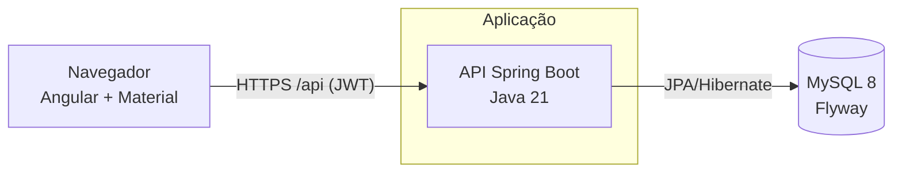

# Sistema bancário

Sistema bancário da disciplina de Introdução ao Desenvolvimento Web (UFF).

Começou como uma aplicação JSP/Servlets/JDBC (NetBeans + Tomcat) e foi migrado para uma arquitetura
atual: **API em Java 21 + Spring Boot** e **frontend em Angular + Angular Material**, com banco
MySQL versionado por Flyway. O sistema antigo continua disponível na tag
[`legacy-jsp`](https://github.com/gaidzinski07/sistema-bancario/tree/legacy-jsp).

O porquê de cada decisão, o inventário de problemas do legado e o histórico das fases estão em
[`docs/plano-migracao.md`](docs/plano-migracao.md).

## O que o sistema faz

**Cliente**: login por CPF, contas corrente e poupança com saldo, extrato por período, depósito,
saque, transferência (com confirmação por senha de transação e proteção contra envio duplicado),
fundos de investimento com aplicação, carteira com rendimento e resgate parcial ou total.

**Administrador**: cadastro de clientes e abertura de contas, agências, fundos e cota diária,
cadastro de administradores.

## Arquitetura



| Pasta | Conteúdo |
|---|---|
| [`backend/`](backend/README.md) | API REST: Spring Boot 4, Spring Security (JWT), JPA/Hibernate, Flyway; monólito modular por domínio (`identidade`, `clientes`, `agencias`, `contas`, `investimentos`) |
| [`frontend/`](frontend/README.md) | Angular 22 (standalone, signals) + Angular Material; testes com Vitest e Playwright |
| [`docs/`](docs) | plano de migração e coleção do Postman |
| `Dockerfile` | imagem única: API servindo o build do Angular |
| `docker-compose.yml` | MySQL de desenvolvimento e, opcionalmente, a aplicação completa |

Destaques: saldo sempre consistente com o extrato (todo movimento gera lançamento na mesma
transação), locks pessimistas contra operações simultâneas, valores em `BigDecimal`, senhas em
BCrypt, refresh token com rotação e detecção de reuso, erros no formato ProblemDetail (RFC 9457).

## Rodando

### Tudo em containers (o jeito mais rápido)

Requer Docker.

```bash
docker compose --profile completo up -d --build
```

Abra http://localhost:8080. Na primeira vez o build da imagem leva alguns minutos.

### Para desenvolver

Requer Docker, JDK 21 e Node 22 (versão em `frontend/.nvmrc`).

```bash
docker compose up -d mysql
```

```bash
cd backend && ./mvnw spring-boot:run
```

```bash
cd frontend && npm ci && npm start
```

Front em http://localhost:4200 (o `ng serve` repassa `/api` para a API na porta 8080) e
documentação da API em http://localhost:8080/swagger-ui.html.

### Usuários de teste

O ambiente de desenvolvimento carrega dados de exemplo: clientes, um administrador, contas com
saldo e fundos. CPFs e senhas estão no cabeçalho de
[`V1_1__seed_dev.sql`](backend/src/main/resources/db/seed/V1_1__seed_dev.sql). Esses dados **não**
existem em produção.

## Testes

```bash
cd backend && ./mvnw verify            # unitários + integração com MySQL real (Testcontainers)
cd frontend && npx ng test --watch=false
cd frontend && npx playwright test     # ponta a ponta; exige a API no ar
```

O CI ([`.github/workflows/ci.yml`](.github/workflows/ci.yml)) roda os três a cada pull request.

## Produção

A imagem sobe com o profile `prod`: sem dados de exemplo e sem Swagger. Variáveis obrigatórias:

| Variável | |
|---|---|
| `DB_URL`, `DB_USER`, `DB_PASSWORD` | conexão com o MySQL |
| `JWT_SECRET` | chave de assinatura dos tokens, Base64 com 256 bits ou mais (`openssl rand -base64 48`) |
| `BANCO_ADMIN_INICIAL_CPF`, `_NOME`, `_SENHA` | só no primeiro deploy: cria o primeiro administrador se não houver nenhum |

```bash
docker build -t banco .
docker run -p 8080:8080 -e DB_URL=... -e DB_USER=... -e DB_PASSWORD=... -e JWT_SECRET=... banco
```
